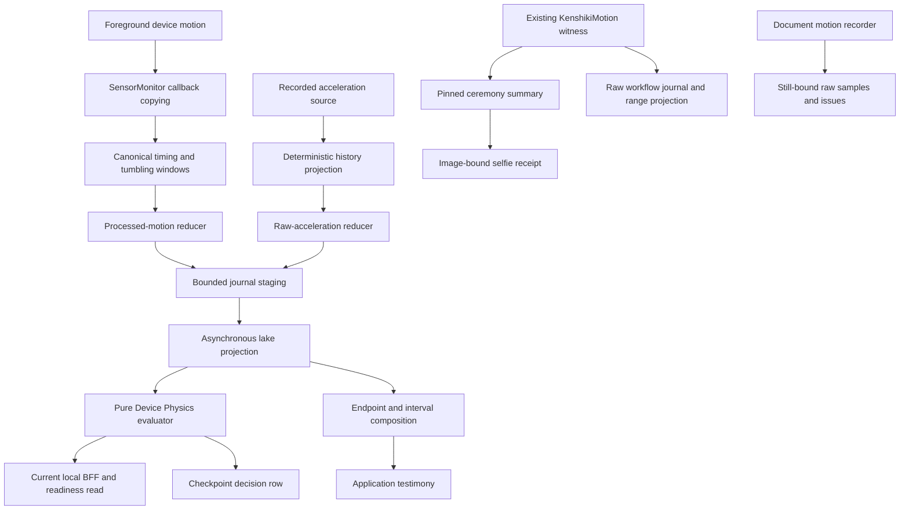

# Motion-first Sensors SDK reuse map

Reviewed: 2026-10-26. Status: source inventory complete for this bounded slice.
The subsequent [first foundation increment](../../../foundation/sensors/README.md)
implements the shared contract and extracted core; this report preserves the
preceding audit's findings and source snapshot.

Pulse already implements the principal mechanisms needed for this motion slice.
The next work is contract reconciliation and extraction of those mechanisms with
their tests. A new statistics library, replacement collector or new liveness model
is not justified by this audit.

The owner-selected destination is an independently consumable Sensors SDK product
inside `kenshiki-sdks`, with shared source under `foundation/sensors/`. That package
was not yet created at the audit checkpoint. The subsequent first increment now
provides the local Sensors package alongside existing `foundation/motion/`;
the repository-root Swift manifest does not export these nested products.
Implementation planning remains governed by [APP-ARCH-001](../APP-ARCH-001.md).

## Read the result

| Evidence | What it establishes |
| --- | --- |
| [Acquisition and custody](acquisition-custody.md) | Active foreground/recorded-acceleration paths, window routing, staging, history and erase seams; aggregate retention and retry/disposal limits |
| [Mathematics and tests](mathematics-tests.md) | Existing equations, weighting, coverage, quantiles, spectral definition, compatibility semantics and inspected test IDs |
| [Fusion and BFFs](fusion-bff.md) | Checkpoint producer, current-read re-evaluation, physical-source accounting, descriptive kinematic composition and application-policy boundary |
| [SDK comparison](sdk-comparison.md) | Current shared witness, document/selfie bindings, workflow raw recording/projection and actual differences |
| [Source baseline](baseline.json) | Both current checkout revisions/branches/status/worktrees; initial parent input hashes |
| [Executed verification](verification.json) | Current shared-package command, source hashes, 18 executed test identities, toolchain and artifact digests |

Each component report has an adjacent `.sources.json` with exact file identities
and its hash-interval limits. The combined [audit verification record](audit-verification.json)
records the final source/hash/link checks. Initial and final hashes establish only
their recorded interval; a dirty checkout is not described as a clean release.

## Active flows

This is a component/call-boundary map, not a claim that all reads share a
transaction or await the same durability boundary. Journal-aware reads can merge
pending and projected rows. Current Home fusion evaluates supplied rows afresh;
it does not decode the persisted checkpoint decision. The diagram also keeps the
separate raw-capture paths separate from minute aggregates.

## Concrete reuse boundary

| Existing mechanism | Sensors SDK boundary | Consumer-owned boundary |
| --- | --- | --- |
| `SensorVector3`, `EmpiricalDistribution`, `SensorTemporalSummary` | Existing measurement/statistics/temporal-support kernels and conformance vectors | Interpretation, display wording and product thresholds |
| Sensor clock/source/session values, specifications and `TumblingSensorWindow` | Existing time domains, routing, completion and admission mechanics | Selected cadence, lifecycle, consent and retention profile |
| Device-motion and recorded-acceleration reducers | Separate processed-motion and gravity-including raw-acceleration profiles | Pulse row vocabulary and lake encoding |
| Native source adapters and bounded staging owner | Existing copying/provider/sink seams; preserve pause/retry/settlement behavior | Monitor singleton, storage namespace, scheduling and erase composition |
| Existing `KenshikiMotion` witness/summary | Preserve current APIs, exact summary/hash semantics and tests | Capability capture binding and workflow identity |
| Pure fusion and interval/aggregate composition | Reusable mechanics only after neutral input/output ownership is identified | Pulse source taxonomy, ladder values, Connect/holder policy and day stories |
| Workflow raw overlap/range mechanisms | Reusable behavior already exists; separate neutral portions as needed | Face/passport DTOs, semantic actions, persistence and host workflow decisions |

The first concrete core boundary is the existing clock/window/statistics/reducer
set with its existing tests. This finding does not authorize copying Pulse's
entire evidence lake, monitor or BFFs into foundation. Document/selfie image
bindings and authoritative server identity decisions retain their own ownership.

## Differences that need a contract decision

1. **Raw and aggregate evidence are distinct.** Pulse foreground minute windows
   and recorder-history rows retain statistics/timing, not callback arrays. The
   SDK journey journals raw windows; the selfie receipt retains a summary and
   fingerprint; document front retains raw callbacks with issues and omissions.
   Preserve all these existing profiles rather than claiming one reconstructs another.
2. **Retention and clocks differ.** Shared witness: rolling five seconds / 300
   samples at requested 50 Hz. Document front: first 600 callbacks at requested
   100 Hz, quaternion and bracketed host/boot correlation. Pulse foreground:
   requested 12 Hz, canonical 60-second aggregates. These rates, frames, boundaries
   and quality meanings are not interchangeable. Camera association is separate
   from measured exposure-time alignment.
3. **Acknowledgement has a scope.** Pulse history acknowledges journal staging
   before SQL projection. After three projection failures its salvage policy can
   remove refused rows, including all rows during a store-wide failure. Reuse of
   this mechanism needs explicit disposition semantics for acknowledged evidence.
4. **Derived lineage needs all deciding inputs.** Existing fusion records policy
   version and supporting IDs, but contradictory rows can decide the outcome
   without entering that supporting-ID list. Current-read re-evaluation and
   checkpoint audit publication are distinct artifacts; the producer discards
   its default commit-health result. Exact input/configuration/digest bindings
   need explicit reconciliation.
5. **Preserve legacy mathematics.** The existing ceremony spectrum uses signed
   axes and integer-Hz Goertzel bin sums with an effective average rate. It does
   not qualify irregular timing or guarantee full 8–12 Hz coverage at low rates.
   Sample RMS, R7 quantiles, last-event compatibility fields, undefined gravity
   fallback and nominal support-cell estimates keep their original meanings.

These are demonstrated differences and limits. Detailed conformance candidates
are in the mathematics report; they are not a commitment to implement every
candidate during extraction. Fine nonzero micromovement must remain recorded;
neither decimal precision nor a computed feature establishes physical resolution
or human handling.

## Verification and limits

- Executed `python3 foundation/motion/check.py`: **18 required tests passed**,
  source unchanged, warnings-as-errors enabled. The receipt includes the exact
  test IDs and hashes. This is macOS execution of the existing shared package.
- Pulse math, aggregation, journal, fusion and BFF suites were read as source;
  they were not executed. Document/workflow suites were also inspected only.
- No source implementation, package migration, installation, device-data change,
  deployment or physical acceptance occurred in this audit.
- This is motion-first coverage, including related source accounting and endpoint
  joins. It is not a complete audit of every Pulse sensor, SQL internals, privacy
  store inventory, downstream view, loader, platform contract or server authority.
  Exact omissions are recorded in each component report.
- SHF data and A-Live were not needed to locate this existing implementation.
  Their physical/research claims remain unqualified by this source audit.

## Checklist result

[Persistent checklist](../telemetry-audit-checklist.md): T07 and T26 completed the
declared motion-first reuse slice. The subsequent implementation completed T32,
T34 and T35 for the first Swift foundation slice, with separate native receipts.
The audit's earlier 18 shared-motion tests remain distinct from the new Sensors
47-case suite. Physical qualification and app adoption remain separate work.
